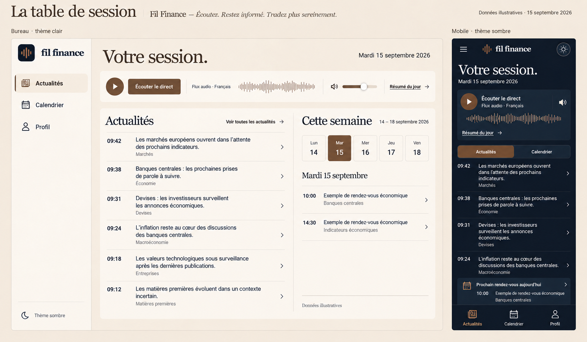
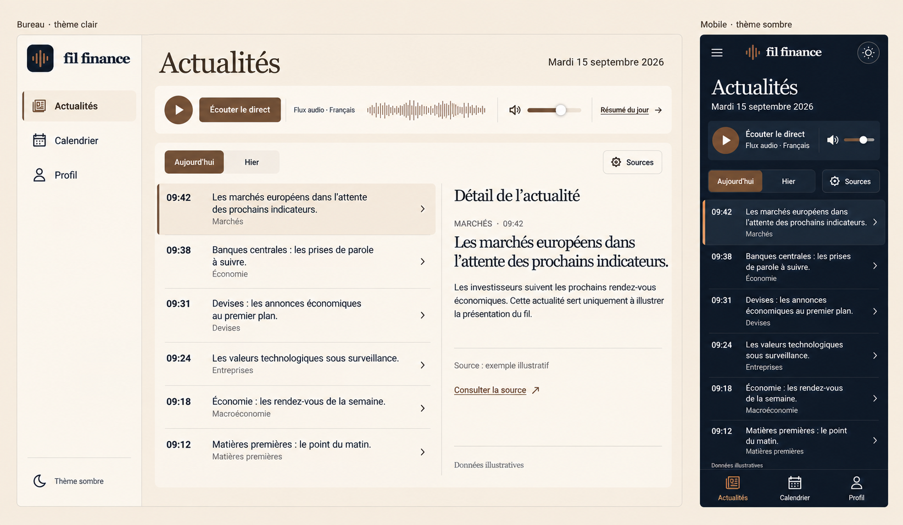
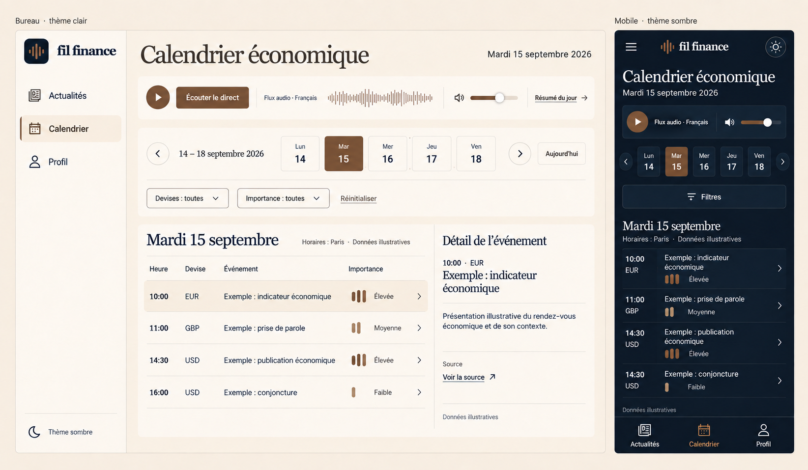
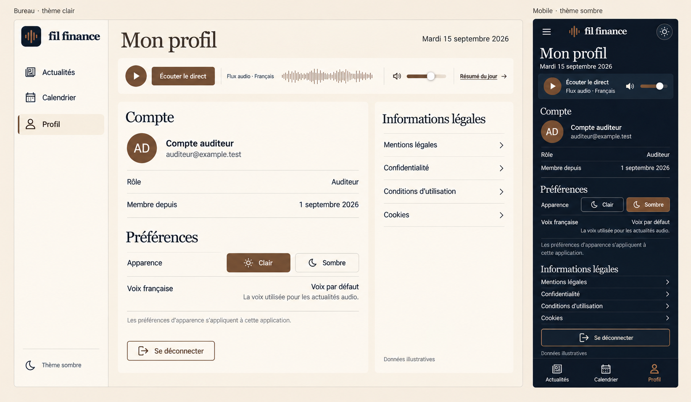
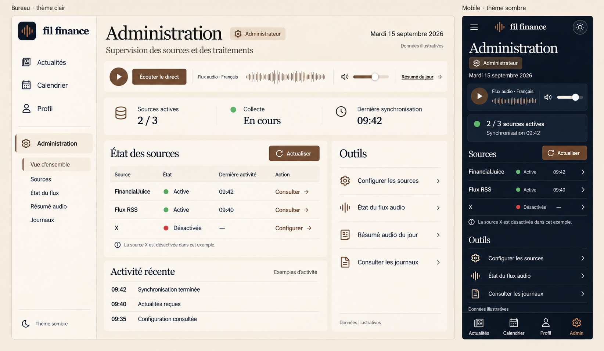

# PWA — La table de session

Référentiel du 16 septembre 2026 pour [EPIC-039](../../epics/EPIC-039-refonte-pwa-gluestack.md).
**Cible documentée, non implémentée.** La livraison NEWS-227 porte sur les documents
et les images ; les tickets suivants réaliseront la refonte. Recette prévue sur
la PWA Web, mobile et ordinateur ; compatibilité Expo conservée, sans livraison native.

## Direction et priorité des références

« La table de session » associe une navigation stable, une typographie éditoriale,
un lecteur audio commun et des listes denses mais lisibles. Les quatre déclinaisons
sont Actualités, Calendrier, Profil et Administration. L'authentification et toutes
les sous-pages admin doivent aussi adopter ce socle, même sans planche dédiée.

Les règles écrites, les permissions et les données réelles priment sur les images.
Les valeurs communes à la [landing](../landing/README.md) assurent l'unité visuelle ;
les préférences des deux applications restent indépendantes.

## Palettes

| Token cible | Usage | Clair | Sombre |
| --- | --- | --- | --- |
| `background` | Fond principal | `#F1E5D3` | `#111827` |
| `surface` | Panneaux, champs et lecteur | `#FBF5EB` | `#192535` |
| `textPrimary` | Texte principal | `#382E26` | `#FBF5EB` |
| `textSecondary` | Texte secondaire | `#796B5D` | `#F1E5D3` |
| `accentDecorative` | Décoration, onde audio | `#7B5E45` | `#8B5E3C` |
| `primaryBackground` | Bouton principal | `#7B5E45` | `#714426` |
| `primaryText` | Libellé du bouton | `#FBF5EB` | `#FBF5EB` |

Petit texte sur fond avoine : **brun principal**, car le taupe n'y atteint qu'environ
4,15:1. Le taupe peut être utilisé sur crème lorsque le contraste est suffisant.
En sombre, le cuivre reste décoratif ; les libellés interactifs sont crème ou avoine.
Les liens dans le contenu sont soulignés ; leur sens ne dépend pas de la couleur.

### États et tokens complémentaires

Ces règles complètent la palette sans introduire une seconde charte. NEWS-228
les traduira en tokens typés partagés. Les contrastes seront mesurés sur les
couleurs réellement composées : au moins 4,5:1 pour le petit texte, 3:1 pour les
repères nécessaires à l'identification des contrôles et les indicateurs de focus.

| État | Règle clair / sombre |
| --- | --- |
| Sélection de ligne | Fond `background` sur panneau `surface`, texte principal, trait latéral `textPrimary` et état sélectionné annoncé ; ne pas compter seulement sur la nuance du fond |
| Choix actif ou bouton | `primaryBackground` + `primaryText`, état pressé/sélectionné exposé ; contour contrasté si le fond seul ne distingue pas le contrôle en sombre |
| Bordure décorative | `textPrimary` à 18 % sur son fond ; ne sert pas seule à identifier un champ |
| Bordure de contrôle | Clair `#796B5D`, sombre `#F1E5D3` ; 1 px, sans opacité |
| Focus clavier | Anneau 2 px `textPrimary`, décalage 2 px laissant voir le fond ; visible sans être coupé par un conteneur |
| Survol | Sur lignes, fond de sélection et soulignement de l'action ; sur boutons, contour `textPrimary`, sans réduire le contraste du libellé |
| Pressé | Même palette que l'actif, variation de contour ; pas d'animation indispensable au sens |
| Désactivation volontaire | Fond `surface`, texte principal, libellé « Désactivée » ou explication, icône neutre ; aucun point rouge ni succès implicite |
| Chargement | Texte principal et indicateur accessible, zone occupée stable ; distinguer attente, vide et erreur |

| Token sémantique | Clair | Sombre | Présentation |
| --- | --- | --- | --- |
| `successText` | `#166534` | `#86EFAC` | Succès/actif confirmé, icône et libellé |
| `errorText` | `#991B1B` | `#FCA5A5` | Erreur effective, message et action de récupération |
| `warningText` | `#713F12` | `#FDE68A` | Avertissement explicite, distinct d'une erreur |
| `infoText` | `#382E26` | `#F1E5D3` | Information neutre, aide ou source désactivée |

Les états sémantiques utilisent `surface` comme fond ; pas de nouveau fond coloré
par écran. Les contrôles indisponibles exposent leur état désactivé, empêchent
l'action et restent compréhensibles sans simple baisse d'opacité. Un état de
source désactivée est une donnée lisible, pas nécessairement un contrôle désactivé.
Ne pas appliquer les couleurs succès/erreur à une variation de marché sans libellé.

## Typographie et dimensions

| Rôle | Famille Web | Taille |
| --- | --- | --- |
| Marque et titres | `Georgia, "Times New Roman", Times, serif` | Marque adaptée au contenant ; page 36 px à partir de 1024 px, 30 px en dessous |
| Titre de section | Même famille serif | 24 px |
| Corps, contrôles, navigation, tableaux | `Arial, Helvetica, sans-serif` | 16 px |
| Métadonnées | Même famille sans-serif | 14 px minimum |
| Contenu technique des logs | Police monospace existante | 14 px minimum, zoom et sélection préservés |

Interligne cible : 1,2 pour les titres, 1,5 pour le corps et les messages.
Chiffres tabulaires pour heures et colonnes numériques lorsque disponibles.
Les replis sont ceux de la landing ; aucune police propriétaire téléchargée.
Sur Expo natif, prévoir un mapping de familles système par plateforme, sans
passer une liste CSS comme nom de police native ; cette compatibilité ne vaut
pas recette iOS/Android dans cet EPIC.

Espacements : **4, 8, 12, 16, 24, 32 px**. Rayons : **6 px** pour les contrôles,
**8 px** pour les surfaces. Cibles tactiles : **44 × 44 px minimum**. Les colonnes
gardent des largeurs souples, les textes longs passent à la ligne. Aucun texte
essentiel tronqué sans moyen accessible de le lire. Ne pas reproduire les petites
métadonnées ou les contrôles trop étroits des planches.

Réutiliser les assets de marque existants, notamment
[l'icône PWA](../../../apps/pwa/assets/icon.png) et son
[favicon arrondi](../../../apps/pwa/assets/favicon.png). Les icônes dessinées par
ImageGen ne sont pas de nouveaux assets à extraire. Aucun nouveau logo.

## Architecture cible et migration

Le socle utilise Expo Router, Expo `~55.0.23`, React `19.2.0`, React Native
`0.83.10` et la filière **gluestack-ui v5 + UniWind + Tailwind CSS 4** :

| Dépendance | Version verrouillée |
| --- | --- |
| `@gluestack-ui/core` | `5.0.15` |
| `@gluestack-ui/utils` | `5.0.6` |
| `uniwind` | `1.3.0` |
| `tailwindcss` | `4.1.18` |
| `react-native-svg` | `15.15.3` |
| `@expo/vector-icons` | `15.1.1` |

Cette décision remplace le maintien de NativeWind du premier plan documentaire.
Le [guide technique](../../guides/pwa-ui-stack.md) décrit Metro, les variables CSS,
les composants, le thème et la reproduction des contrôles. La
[filière officielle v5](https://gluestack.io/ui/docs/guides/more/upgrade-to-v5) et
[la configuration CSS UniWind](https://docs.uniwind.dev/theming/global-css)
servent de références techniques. Aucun moteur graphique parallèle n’est conservé.

| Niveau | Emplacement cible dans `apps/pwa/src` | Responsabilité |
| --- | --- | --- |
| Tokens et thème | `global.css` + `shared/theme/` | Valeurs CSS uniques, lecture JavaScript par UniWind, préférence locale |
| Primitives gluestack | `shared/ui/primitives/`, exports via `shared/ui` | Bouton, texte, champ, sélecteur, badge, dialogue, panneau mobile, chargement |
| Composants Fil Finance | `shared/ui/` | Présentation commune contrôlée par données, états et callbacks |
| Compositions métier | `features/*/components/` et écrans existants | Relier hooks, permissions, données et composants |
| Cadre connecté | `application/` et layout protégé existant | Navigation, audio persistant et orchestration des pages |
| Routes | `app/` | Routes Expo Router minces, délégation aux fonctionnalités |

Les composants partagés ne chargent aucune API et n'importent aucune feature.
Les détails gluestack ne doivent pas se disperser dans les écrans. Les hooks et
services métier restent à leur place ; les exports publics évitent les imports
profonds. Conserver les contrôles d'architecture existants et les commentaires
de code en français.

### Catalogue réutilisable cible

Noms indicatifs ; le contrat de responsabilité est obligatoire. Les variantes
sont sémantiques, pas des palettes libres passées par chaque écran.

| Composant | Entrées et comportements partagés | Usages |
| --- | --- | --- |
| `PageHeader` / `Section` | Titre, description, actions, enfants ; niveaux de titre cohérents | Toutes les pages |
| `DataRow` / `ResponsiveTable` | Colonnes, lignes identifiées, sélection et callbacks ; en-têtes accessibles, rendu compact mobile | News, événements, admin |
| `DetailPanel` | Ouvert, titre, contenu, fermeture ; focus initial, Échap, retour au déclencheur | News et calendrier, détails admin |
| `FilterBar` | Valeurs contrôlées, options, changement, remise à zéro ; panneau mobile avec libellés | Historique, calendrier, admin |
| `AsyncState` | Chargement, vide, erreur et callback de reprise explicite ; annonce non intrusive | Toutes les vues de données |
| `StatusBadge` | État sémantique et libellé, icône ; aucun sens uniquement coloré | Flux, sources, traitements |
| `PreferenceGroup` | Libellés, descriptions et contrôles/enfants ; lecture seule possible | Profil et configuration |
| `AppNavigation` | Routes autorisées, route active, navigation et menu | Cadre connecté |
| `AudioPlayerView` | État réel du moteur et callbacks existants, sans moteur ni abonnement interne | Lecteur commun |

Les anciens `ActionButton`, `Card`, `PageHeaderCard`, `ScreenShell`, `WebSelect`,
`appDesignTheme`, la palette admin et la façade `AdminDashboard` sont supprimés.
`Workspace.tsx` regroupe les compositions génériques de données dans `shared/ui`
et importe les mêmes `Surface`, `DataRow`, `Button` et `StatusBadge` que les pages
utilisateur. Les composants partagés ne dépendent pas des fonctionnalités.
Le lecteur de logs conserve son arbre et sa virtualisation DOM, ses limites et
ses en-têtes ; ses actions, polices et couleurs suivent le socle commun.

## Navigation et audio

- **À partir de 1024 px** : barre latérale persistante. En dessous : navigation
  inférieure et menu complémentaire ; la page active est annoncée. L'entrée admin
  et ses destinations sont réservées au rôle autorisé, sans affaiblir les gardes.
- **À partir de 1280 px** : liste et détail côte à côte. En dessous : panneau
  adapté avec retour, fermeture clavier, focus initial et restauration au retour.
  Sous 1024 px, tenir compte de la navigation inférieure et des zones sûres.
- Le lecteur commun et son moteur restent montés dans le cadre des pages connectées, y compris
  l'admin autorisée. Aucun lecteur sur les écrans d'authentification.
- Réutiliser le moteur audio, ses hooks et sa gestion du résumé existants. Aucun
  second abonnement, autoplay ajouté, ni redémarrage à la navigation ou au thème.
  L'onde graphique ne doit jamais faire croire à une lecture inexistante.
- Préserver le défilement utile et la sélection lors des transitions prévues par
  les fonctionnalités. Les panneaux/tableaux peuvent avoir un défilement interne
  explicite ; jamais de débordement horizontal de toute la page.

## Thème unique dans la PWA

Conserver la clé AsyncStorage **`filfinance.theme`**, les valeurs `light` et `dark`
et le **clair par défaut**, indépendamment du système. Un état unique pilote les
tokens Fil Finance, gluestack et UniWind. Les commandes du cadre et du profil
modifient ce même état et exposent leur nom et leur sélection aux aides techniques.

Restaurer le choix avant l'affichage de contenu dans le mauvais thème. Le provider lit synchroniquement le stockage Web avant son montage, sans bloquer indéfiniment
le rendu. Une valeur absente/invalide ou une lecture impossible conduit au clair ;
une écriture refusée conserve la bascule en mémoire pour la visite. Une lecture
asynchrone tardive ne doit pas écraser un choix explicite récent. Aucun rejet de
stockage non intercepté. Ne pas coupler à `filfinance.landing.theme` ni au profil
serveur ; ne pas remonter l'arbre audio à la bascule.

## Pages et correspondance exhaustive avec les tickets

Inventaire des fichiers Expo Router du 16 septembre 2026. Les groupes `(app)` et
`(auth)` ne font pas partie des URL. Les layouts ne sont pas des pages publiques.

| Route ou layout | Fichier sous `apps/pwa/app/` | Ticket | Contrat préservé |
| --- | --- | --- | --- |
| `/` | `index.tsx` | NEWS-230 | Redirection vers `/feed` |
| Cadre racine | `_layout.tsx` | NEWS-228 | Providers thème et auth |
| Cadre connecté | `(app)/_layout.tsx` | NEWS-230 | Protection de session, audio et navigation |
| Cadre auth | `(auth)/_layout.tsx` | NEWS-234 | Accès sans session, liens légaux |
| `/login` | `(auth)/login.tsx` | NEWS-234 | Connexion, inscription, mot de passe oublié et réinitialisation via les modes existants |
| `/email-verification` | `(auth)/email-verification.tsx` | NEWS-234 | Vérification email et retour existants |
| `/feed` | `(app)/feed.tsx` | NEWS-231 | Historique, sélection, détail, chargement et accès sources autorisés |
| `/calendar` | `(app)/calendar.tsx` | NEWS-232 | Semaine ouvrée, sélection du jour, filtres, événements et détails |
| `/profile` | `(app)/profile.tsx` | NEWS-233 | Compte, thème, voix affichée, déconnexion et quatre liens légaux |
| `/admin` | `(app)/admin/index.tsx` | NEWS-235 | Supervision et accès aux outils |
| `/admin/config-sources` | `(app)/admin/config-sources.tsx` | NEWS-235 | Configuration des sources et permissions |
| `/admin/flux-status` | `(app)/admin/flux-status.tsx` | NEWS-235 | État et supervision du flux |
| `/admin/blacklist` | `(app)/admin/blacklist.tsx` | NEWS-235 | Gestion actuelle de la blacklist |
| `/admin/glossary` | `(app)/admin/glossary.tsx` | NEWS-235 | Gestion actuelle du glossaire |
| `/admin/history` | `(app)/admin/history.tsx` | NEWS-236 | Historique et détails existants |
| `/admin/calendar-history` | `(app)/admin/calendar-history.tsx` | NEWS-236 | Historique calendrier |
| `/admin/calendar-day` | `(app)/admin/calendar-day.tsx` | NEWS-236 | Traitements et détails du calendrier journalier |
| `/admin/daily-summary` | `(app)/admin/daily-summary.tsx` | NEWS-236 | Résumé audio, historique et actions autorisées |
| `/admin/logs` | `(app)/admin/logs.tsx` | NEWS-236 | Journaux, lecteurs techniques et lecture bornée |

Les modes inscription/récupération/réinitialisation ne deviennent pas de nouvelles
routes dans cet EPIC. Préserver aussi les états internes de récupération de session.
NEWS-237 couvre transversalement toutes ces routes et tous les états.

Actualités conserve l'historique actuel : les onglets illustratifs « Aujourd'hui /
Hier » ne réduisent pas les périodes ou fonctions existantes. « Sources » ne crée
aucun droit nouveau. Calendrier réutilise la semaine ouvrée et le repli du jour
sélectionné les week-ends ; les filtres ne changent pas les dates métier. Profil
reste en lecture seule pour le compte et la préférence vocale ; aucun formulaire
de modification de compte ajouté. Les documents légaux restent sur la landing,
avec leurs URL construites depuis la configuration existante.

## Galerie des références actives

Chaque planche contient une vue ordinateur claire et une vue mobile sombre.
Toutes mesurent **1644 × 957 px**. Elles ne dispensent pas d'implémenter et tester
les deux thèmes à chaque largeur. Les alternatives non retenues sont exclues.

### Direction générale — version corrigée

### Actualités

Référence confirmée par le fichier fourni « Image Codex 16 sept. 2026,
11_01_10.png », identique octet par octet à cette copie. **Aucune retouche.**
La page `/feed` contient le lecteur audio, la liste des actualités et leur détail,
**sans calendrier ni aperçu de semaine**. L'entrée « Calendrier » de la navigation
conduit à la page distincte `/calendar`. Cette planche fait foi pour Actualités ;
le calendrier de la direction générale ne doit pas être repris sur cette page.

### Calendrier — version corrigée

### Profil

### Administration

## Provenance et écarts intentionnels

Le [manifeste des images](./maquettes/manifest.json) enregistre pour chacun des
sept fichiers : nom source, répertoire de provenance, date de création, date de
copie, dimensions, taille en octets, SHA-256, statut et éventuel original parent.
Les cinq originaux ImageGen datent du **15 septembre 2026** ; les deux corrections
et l'archivage du **16 septembre 2026**. Aucun PNG n'a été réencodé ou redimensionné
pendant la copie. Les images ne sont pas embarquées dans l'application.

| Original conservé | Statut | Référence à implémenter |
| --- | --- | --- |
| [Direction v1](./maquettes/historique/pwa-table-de-session-v1.png) | Historique, sept jours | [Direction v2](./maquettes/pwa-table-de-session-v2.png) |
| [Calendrier v1](./maquettes/historique/pwa-calendrier-v1.png) | Historique, sept jours | [Calendrier v2](./maquettes/pwa-calendrier-v2.png) |
| [Actualités v1](./maquettes/pwa-actualites-v1.png) | Original actif | Identique |
| [Profil v1](./maquettes/pwa-profil-v1.png) | Original actif | Identique |
| [Administration v1](./maquettes/pwa-administration-v1.png) | Original actif | Identique |

Corrections ImageGen limitées à la semaine affichée : **lundi 14, mardi 15,
mercredi 16, jeudi 17 et vendredi 18 septembre 2026**, mardi sélectionné et plage
du 14 au 18. Contrôle visuel effectué sur les sélecteurs ordinateur et mobile de
Calendrier, ainsi que sur le sélecteur ordinateur de la direction générale.
Sa vue mobile ne contient pas de grille hebdomadaire : elle reste inchangée et
n'a pas reçu de composant supplémentaire. La composition générale est conservée ;
une régénération ImageGen n'est pas une garantie d'identité pixel par pixel hors
du calendrier. Les originaux exacts restent disponibles pour comparaison.

Écarts à respecter lors de l'implémentation :

- Les couleurs, tailles, contrastes et tokens écrits priment sur les textures,
  petites légendes et couleurs approximatives des PNG.
- Le point rouge « Désactivée » de la planche admin devient **neutre**. Les sources,
  compteurs, heures, rôles et emails affichés sont illustratifs, jamais des données
  à injecter dans la PWA. La dernière heure du calendrier mobile diffère de la
  vue ordinateur : afficher la donnée réelle, sans recopier cette incohérence.
- Les pictogrammes de marque restent ceux du dépôt. Les symboles de thème
  approximatifs de la planche Profil ne changent ni le libellé ni l'état annoncé.
- La planche direction est une intention de composition, pas une nouvelle route
  « Votre session » ni un remplacement des pages fonctionnelles existantes.
  Son aperçu de calendrier ne s'applique pas à la page Actualités, dont la
  planche dédiée est conservée sans modification.
- Les menus admin abrégés des images doivent donner accès à **toutes** les routes
  inventoriées ; les graphiques/ondes décoratifs n'inventent aucun état de lecture.
- La PWA utilise cinq jours ouvrés ; l'exemple public de la landing à sept jours
  n'est pas modifié par cette livraison.

## Validation et séparation des preuves

La [recette documentaire](./recette-documentaire-2026-09-16.md) couvre les copies,
empreintes, dimensions, galerie, liens, identifiants et inventaire. Ce sont des
**références visuelles**, pas des captures de l'application réalisée.

Les futures captures de recette seront rangées séparément sous `recette/<date>/`
avec commit/état local, viewport, thème, rôle, données de test et résultats. Les
preuves d'un éventuel déploiement préciseront environnement et SHA à part.
Aucune preuve de production ni certification native n'est apportée par ce dossier.

La recette future couvre les deux thèmes à **320, 390, 768, 1024 et 1440 px**,
le zoom 200 %, le clavier, le focus, les panneaux et lecteurs d'écran ; les états
chargé, chargement, vide, erreur, déconnecté, accès refusé et reconnexion ; les
parcours utilisateur/admin, les liens légaux, les thèmes et la continuité audio.
Exécuter `npm run check:pwa` et `npm run build:pwa` depuis la racine, dont les
contrôles d'architecture. Adapter les attentes visuelles devenues obsolètes, sans
supprimer leurs garanties métier. La clôture globale appartient à NEWS-237.

## Implémentation locale et preuves

La recette est séparée des maquettes dans recette/2026-09-16 (preuve interne conservée dans GitLab, exclue du dépôt de présentation).
Les captures utilisent des réponses API fictives et ne montrent pas la production.
Actualités ne contient aucun calendrier. Le lecteur présente les commandes réelles
sans curseur de volume, sans onde simulant une lecture et sans donnée inventée dans
le code livré. Les fonctions admin supplémentaires restent disponibles.

La palette CSS comprend aussi les tokens sémantiques suivants : succès clair
`#166534` / sombre `#86EFAC`, erreur `#991B1B` / `#FCA5A5`, avertissement
`#713F12` / `#FDE68A`. Les libellés secondaires affichés sur le fond avoine restent
en brun principal. La sélection reprend le fond contrastant avec la surface ;
le focus reprend la couleur de texte principal ; les contrôles désactivés ont
un état accessible et une opacité réduite. Le survol renforce le contour.

## Livraison locale — 16–17 septembre 2026

La migration gluestack v5 / UniWind / Tailwind CSS 4 est implémentée sur toutes les
routes. Les captures et résultats sont séparés des références :
recette locale (preuve interne conservée dans GitLab, exclue du dépôt de présentation),
[guide technique](../../guides/pwa-ui-stack.md),
[revue visuelle](../../../apps/pwa/design-qa.md).
Le lecteur, les thèmes et la navigation sont partagés ; les contrats et droits
existants restent inchangés. Aucun commit, push ou déploiement.
